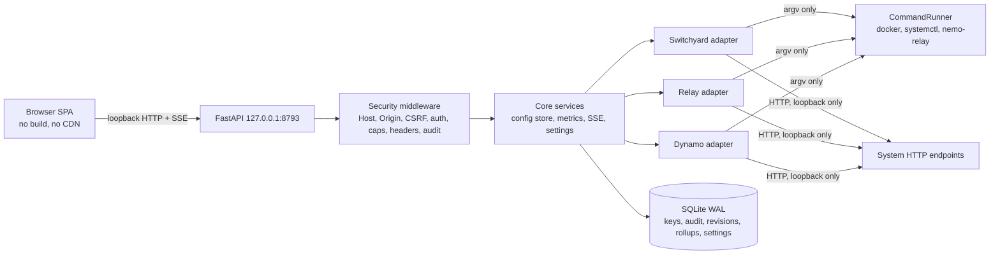

# Nemo Console

A local, single-user web console to **monitor, configure and interact with** four NVIDIA-ecosystem systems
running on one workstation:

- **NeMo Switchyard**: tier-based request routing (an HTTP server in a container).
- **NeMo Relay**: an agent gateway with plugin policy and ATOF/ATIF trace export (a host binary, run as a
  systemd user unit).
- **NVIDIA Dynamo**: an LLM serving frontend plus a vLLM worker (docker compose).
- **NVIDIA SkillEvaluator** (unreleased): scores agent skills (`SKILL.md` folders) for quality, security and
  duplication. A CLI, not a service: the console runs it on demand and keeps the reports.

It is a host-run FastAPI process bound to loopback, with a zero-build, zero-npm browser UI. One adapter per
system plugs into a system-agnostic core; the UI renders from descriptors (status, metrics, config files,
parameters, actions, playground), so adding a system is one adapter file (SkillEvaluator was added that way).

> **Status: v0.1.2.** Read the [status vocabulary](#status-vocabulary) before trusting any claim in these docs.
> Nothing here has been used by anyone other than its author, on one workstation, against one set of pinned
> versions (Switchyard 0.3.0, Relay 0.9.2, Dynamo 1.5.0).

## Status vocabulary

Every feature claim in this repo is one of:

| Label | Meaning |
|---|---|
| **implemented** | Read in the code; covered by offline tests using fakes and captured fixtures. Not exercised against the real system. |
| **verified-live** | Exercised against a real Switchyard 0.3.0, Relay 0.9.2 and Dynamo 1.5.0 on one workstation (evidence is stated in [`docs/FEATURE-MATRIX.md`](docs/FEATURE-MATRIX.md)). |
| **unverified** | Only fakes have run it. It may work; nobody has watched it work. |

Gate results (re-run on 2026-09-28 against the release tree): `pytest -q` 384 passed / 3 skipped in the author's
deployment checkout (the skips are opt-in or environment-gated live smoke tests; the Dynamo live smoke enables itself
when a frontend answers on 127.0.0.1:8020), `ruff check` clean, `mypy --strict src` clean (41 files), `node --test` 94
passed. From a clean copy of the release tree outside that checkout (`make setup && make all`): 382 passed / 5 skipped,
ruff and mypy clean, frontend 94 passed; the extra skips are the tests that need the deployment's repository layout. Mermaid diagrams in these docs were **not
rendered**; treat them as unvalidated.

## What it does

| Area | What you get |
|---|---|
| Observe | Health and status per system with actionable problems (each with one copy-pasteable fix), live metrics with 15 min / 1 h / 24 h history, a topology view, live event streams (SSE), and a routing summary (by route, model, tier, tokens, errors) derived from Switchyard's routing log. |
| Configure | Switchyard `routes.toml` editor: validate, diff, confirm, backup, atomic write, recreate the container, health check, **automatic rollback** if unhealthy, revision history and manual rollback. Relay `routes.toml` the same way (with a weaker validator, stated in the UI). Dynamo tunables as a structured parameter form that renders a compose override file. |
| Act | Per-system actions with danger levels (safe / disruptive / destructive) and mandatory confirmation. Dynamo up/down/restart with a **preflight** that names what shares the GPU. |
| Interact | A playground that sends one chat request through a system, streamed, never stored. |
| Audit | Append-only record of every mutating call (params redacted, chat text and file bodies never stored). |

## Architecture at a glance



*(Unrendered Mermaid.)* Details: [`docs/ARCHITECTURE.md`](docs/ARCHITECTURE.md) (the locked contract),
[`docs/adr/`](docs/adr/) (14 decisions with rejected alternatives), [`docs/THREAT-MODEL.md`](docs/THREAT-MODEL.md),
[`docs/OPERATIONS.md`](docs/OPERATIONS.md), [`docs/FEATURE-MATRIX.md`](docs/FEATURE-MATRIX.md), [`docs/PUBLISHING-CHECKLIST.md`](docs/PUBLISHING-CHECKLIST.md),
[`CHANGELOG.md`](CHANGELOG.md).

## Quick start

Prerequisites: Linux, Python 3.13 (`uv` recommended; newer interpreters may lack wheels), Docker (rootless
works and is what the author used), the three systems deployed the way the adapters expect (see
[Deployment assumptions](#deployment-assumptions)), Node 22 only if you run the frontend tests.

```bash
make setup          # uv venv --python 3.13 && uv sync --frozen
make run            # serves API + UI on http://127.0.0.1:8793
make all            # ruff + mypy --strict + pytest + node --test (all offline)
make install-desktop  # optional (Linux): "Nemo Console" in your app menu; see docs/OPERATIONS.md section 3
```

**A key is required for everything except `GET /api/v1/health`.** First start writes an admin API key to
`<state dir>/bootstrap-admin.key` (mode 0600) and logs its path. Open the UI: it prompts for a bearer; paste the key
(kept in the tab's `sessionStorage`). Mint more with `nemo-console mint-key [admin|viewer]`, which prints only the path
of a 0600 key file. Full instructions: [`docs/OPERATIONS.md`](docs/OPERATIONS.md).

UI without a backend (canned data, nothing verified about real systems): `cd frontend && node dev/mock-server.mjs`
(its default port is 8796; the real backend is 8793; pass `--port` to change the mock's).

## Security posture (summary)

To report a vulnerability, see [`SECURITY.md`](SECURITY.md).

Loopback bind; `Host` allowlist (421); same-origin-or-absent `Origin` on unsafe methods (403); `X-Console: 1`
on every non-GET (403); bearer keys stored as SHA-256 with `admin` / `viewer` roles (an unauthenticated caller is
role `public` and gets 401 on everything but `/health`); strict CSP and other
security headers on every response including errors; body and SSE caps; all process control through one argv-only
runner with a five-binary allowlist (`docker`, `systemctl`, `nemo-relay`, and the two SkillEvaluator launchers); config writes only to paths fixed at startup, refusing symlinks and
secret-looking content; secrets referenced by environment-variable **name**, never stored or returned; no
outbound network beyond configured loopback URLs.

**Known gaps, stated plainly** (full list in [`docs/THREAT-MODEL.md`](docs/THREAT-MODEL.md)):

- Loopback trust is **off by default**. If you opt in (`NEMO_CONSOLE_TRUST_LOOPBACK=true`) any local process becomes
  `admin` without a key; the console forces it back off when the host is not loopback or `allowed_hosts` is set
  (`/health.trust_notice` says why; it is `null` otherwise). The listen host is still a plain setting and nothing forbids a non-loopback bind.
- The console can start and stop containers and restart a systemd user unit. Compromising it is
  roughly equivalent to compromising the Docker user it runs as.
- Dynamo events are redacted **free-text container log lines**, not allowlisted metadata (see limitations).
- Playground chat text transits the console process in memory and is passed to whichever system you target.

## Known limitations

- **Switchyard "capable tier dark" detection is indirect, with no active request probe.** Two signals exist:
  (a) `switchyard.tier.capable_dark` (setting `engine_probes`, alias to engine container) fires when a mapped alias
  is the `capable_target` model of a `stage_router` route in the parsed `routes.toml` (a passthrough such as
  `direct-*` does not count) and the mapped container is *not running* per `docker inspect`; it makes Switchyard
  `degraded` with a summary prefixed "capable tier dark". Its fix is the container's `engine_start` command when one
  is set, else a guessed `docker compose up -d` in the compose directory. (b) `switchyard.capable_tier.upstream_errors`
  is a traffic heuristic on `/v1/stats` error counts. Neither notices a running-but-broken engine, and (a) only knows
  the containers you list in `engine_probes` (the defaults list two aliases and containers from the author's
  deployment).
- **Playground "served by" headers are guessed.** The console looks for `X-Served-By-Route` style headers
  (several candidate names); they were absent from real Switchyard responses, so the route/tier badges are
  usually empty.
- **Topology edges are approximations** built from adapter health plus probes (router liveness, three
  hard-coded engine containers; opt-in engines that are stopped are drawn `off`, not red). They show "plausible path", not observed traffic. The edge label "agent gateway"
  is partly clipped behind a node in the rendered view (cosmetic, known).
- **`plugins.toml` and `config.toml` (Relay) are read-only by design.** They hold signature-enforcement policy;
  the console shows them and never writes them.
- **The Dynamo tab has no config-file tab.** The backend exposes the compose file (read-only) and the generated
  override through the config API, but the UI only offers the parameter form and lifecycle.
- **`/health` reports the caller's role** (`admin`, `viewer` or `public`) and a `trust_notice`; with the default
  settings an unauthenticated caller sees `public` and a null notice.
- **Dynamo events are redacted log lines**, not an allowlist of metadata fields (ADR-0010 deviation).
- Container, compose-project and unit names for Switchyard, Relay and Dynamo, and the repo layout under the configured
  root, are constants in the adapters. Only the capable-tier alias-to-container mapping and each engine's start
  command are configurable today (`ENGINE_PROBES`, `ENGINE_START`); anything else needs a code edit (see
  [Deployment assumptions](#deployment-assumptions)).
- **Route validators guard against off-box IPs and dotted hostnames, not against a hostile local resolver.** A bare
  single-label hostname (for example `metadata`) is accepted as an in-network "service name"; a resolver search domain
  could send it off the box. An `allowed_service_names` setting is a possible future option, not implemented.
- **Redaction is bounded and chunked** (4000-character chunks, linear time). A secret straddling a chunk boundary could
  slip through.
- **Relay playground has no default credential mapping** (only `switchyard` does).
- **The systemd unit template is untested.** Hardening options that need user namespaces can fail with status
  `226/NAMESPACE` on distributions that restrict unprivileged user namespaces; treat any such option as optional.
- **Dynamo override gaps:** enum-valued flags are not checked against the catalog's choices and numeric values are not
  type-checked in the hand-edited override (admin-only; the command is an argv list, never a shell).

## Deployment assumptions

The adapters were written against one deployment and encode it as constants and default paths
(`resolved_paths()` in `backend/src/nemo_console/config.py`, constants at the top of each adapter):

- Switchyard runs as a docker compose service in a project directory containing `routes.toml` and
  `docker-compose.yml`, with a container name the adapter verifies by compose labels.
- Relay's gateway runs as the systemd user unit `nemo-relay-gateway.service` on `127.0.0.1:4040`.
- Dynamo runs as a compose project with `dynamo-frontend` / `dynamo-worker` services, pinned to a GPU by UUID.
- A LiteLLM-compatible router answers `/health/liveliness` on `127.0.0.1:4000` (topology probe only).
- The root that holds those directories is `NEMO_CONSOLE_REPO_ROOT`. The default walks up from the source file to
  a directory containing `inference/dynamo/docker-compose.yml`, else uses the current directory; a root that lacks that
  file is reported as a problem. For a standalone checkout set it explicitly.

## Repository layout

```
backend/src/nemo_console/
  adapters/     base.py (locked port), switchyard.py, relay.py, dynamo.py
  api/          security.py (middleware), deps.py (roles), errors.py, routers/{observe,configure,act,admin}.py
  services/     runner, config_store, metrics, events (SSE), playground, auth, audit, settings, topology, ...
  domain/       models.py (locked pydantic contract)   migrations/0001_init.sql
frontend/       index.html, js/ (ES modules, web components), css/, i18n/en.json, dev/mock-server.mjs, tests/
backend/tests/  core/ (fakes), switchyard/ relay/ dynamo/ (captured fixtures), *_live_smoke opt-in
deploy/         nemo-console.service (opt-in systemd user unit template)
docs/           ARCHITECTURE.md, adr/, THREAT-MODEL.md, OPERATIONS.md, FEATURE-MATRIX.md, PUBLISHING-CHECKLIST.md
```

## Development

| Target | Does |
|---|---|
| `make setup` | create the venv, install locked dependencies |
| `make run` | serve on 127.0.0.1:8793 |
| `make test` / `lint` / `typecheck` | pytest, ruff, `mypy --strict` |
| `make frontend-test` | `node --test` on the pure-logic modules |
| `make all` | all of the above |

Live smoke tests are read-only against real systems and need the deployment described above. They are gated
inconsistently: Switchyard by `NEMO_LIVE=1`, Relay by `NEMO_CONSOLE_LIVE=1`, Dynamo automatically when
`127.0.0.1:8020/health` answers.

## License and trademarks

MIT; see [`LICENSE`](LICENSE).

This is an independent project. It is not affiliated with, endorsed by or sponsored by NVIDIA. "NVIDIA", "NeMo",
"NeMo Switchyard", "NeMo Relay" and "Dynamo" are names of products of their respective owners and are used here
only to describe compatibility.
