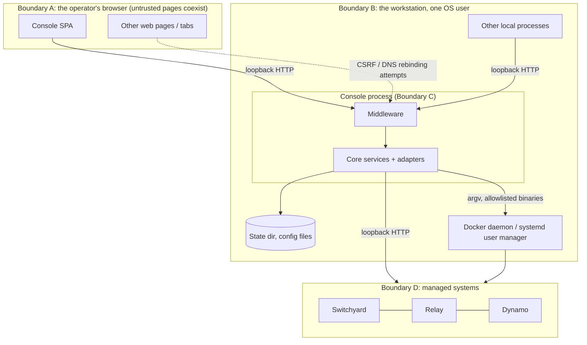

# Threat model

Scope: the Nemo Console process (backend and static frontend) as designed and implemented at v0.1.0, and its
interfaces to the browser, the local operating system, Docker, systemd, and the three managed systems. Written
from the code and tests; nothing here is a penetration-test result.

Evidence labels: **test** = an offline test exists and passed on 2026-09-25 (backend 340 passed / 3 skipped, frontend 94 passed, re-run for this revision); **verified-live** = also exercised
against a real process (the author's checks are listed in [FEATURE-MATRIX](FEATURE-MATRIX.md)); **unverified** =
no test or run. A test proves the control against its fake, not against every real-world input.

## 1. Assets

| Asset | Why it matters | Where it lives |
|---|---|---|
| Admin/viewer API keys | Authorise every mutating call | SHA-256 in `keys` table; plaintext only in 0600 key files created by first start / `mint-key`, and in the operator's browser `sessionStorage` if pasted |
| Playground credential (e.g. a router virtual key) | Spends model capacity, may grant access to other tools | Environment of the console process; referenced by variable **name** only |
| Control of containers and the Relay user unit | Availability of serving stack; effectively the operator's Docker authority | Docker CLI and `systemctl --user` invoked by the runner |
| Router / gateway configuration | Decides which model serves which request | `routes.toml` files (allowlisted paths), Dynamo override in the state dir |
| Relay trust policy (`plugins.toml`, `config.toml`) | Signature enforcement for native plugins | Operator's config dir; read-only to the console |
| Conversation content | Prompts and completions | Playground requests in memory; system logs and ATOF/ATIF traces belong to the managed systems |
| Audit log and config revisions | Accountability and rollback | SQLite `console.db` in the state dir |
| Console availability | Loss means no console, not loss of serving | Process |

## 2. Trust boundaries

*(Unrendered Mermaid.)*

- **A, browser to console.** Anything that can make the browser send a request to `127.0.0.1:8793` is on the
  other side of this boundary: the SPA, other pages (CSRF, DNS rebinding), browser extensions.
- **B, other local processes to console.** Loopback is reachable by every process of every user on the machine.
  With the default `trust_loopback=false` such a process is role `public` (401 everywhere except `/health`); only if the operator opts in with `trust_loopback=true` is it admin without a key.
- **C, console to the OS.** The console runs as the operator. Its power is whatever the operator's Docker and
  systemd user manager allow, narrowed by the runner's allowlist and the adapters' fixed commands.
- **D, console to managed systems.** Data returned by the systems (metrics text, logs, JSON, file contents) is
  untrusted input to the console and must not become code, markup or a path.

**Out of scope / assumed:** the operating system, the kernel, the Docker daemon and the managed systems are
uncompromised; the operator's user account is not otherwise controlled by an attacker; the browser enforces the
same-origin policy and CSP; no remote network access to the port (see residual risk R-1).

## 3. STRIDE table

| ID | Threat | Category | Control (where) | Test proving it |
|---|---|---|---|---|
| S-1 | A web page in the operator's browser calls the API using the operator's ambient loopback access (CSRF) | Spoofing | Same-origin-or-absent `Origin` on unsafe methods, 403 `cross_origin`; `X-Console: 1` required on every non-GET, even with a bearer, 403 `csrf_header_required`; no CORS; bearer in a header, not a cookie (`api/security.py`) | `test_cross_origin_post_is_403`, `test_same_origin_is_allowed`, `test_missing_csrf_header_is_403_even_with_bearer`, `test_get_needs_no_csrf_header`; verified-live for Origin/CSRF |
| S-2 | DNS rebinding: a hostile name resolves to 127.0.0.1 and the page reads API responses | Spoofing / Info disclosure | `Host` allowlist (`127.0.0.1`, `localhost`, `[::1]` plus configured host, each with port) returning 421; CSP `connect-src 'self'` | `test_bad_host_is_421`; verified-live (forged Host gave 421) |
| S-3 | A forged proxy header makes a remote client look like loopback | Spoofing | Loopback trust (itself off by default) is refused when `X-Forwarded-For` or `Forwarded` is present; and is forced off when the host is not loopback or `allowed_hosts` is set (`config.py: effective_loopback_trust`, reported in `/health.trust_notice`) | `test_x_forwarded_for_disables_loopback_trust`, `test_loopback_trust_refused_when_exposure_plausible`; header behaviour verified live |
| S-4 | Guessing or replaying an API key | Spoofing | 256-bit random `nck_` keys, stored as SHA-256, `hmac.compare_digest` over every row, wrong bearer is 401 with no loopback fallback | `test_bearer_keys_roles_and_wrong_key`, `test_keys_are_stored_hashed_and_bootstrap_file_is_0600` |
| S-5 | A local process (or malware as the same user) reaches the loopback port and acts as admin | Spoofing / EoP | **Default is now safe against this:** `trust_loopback=false`, so an unauthenticated caller is role `public` and gets 401 on every route except `GET /api/v1/health`. Only an explicit `NEMO_CONSOLE_TRUST_LOOPBACK=true` (on a loopback host, without `allowed_hosts`) restores key-less admin. A local process that can *read the key file or the browser's `sessionStorage`* is still admin (R-2) | `test_loopback_trust_defaults_off`, `test_default_is_public_role_and_needs_a_key`, `test_explicit_opt_in_still_works_on_plain_loopback`; auth behaviour (public 401, wrong key 401, bootstrap key -> admin) verified live |
| T-1 | Tampering with config via path tricks: `../`, symlinks, swapped parent directory, arbitrary file id | Tampering | Allowlist of resolved absolute paths fixed at startup; symlink refused; path re-resolved before use; ids validated with `fullmatch` (`services/config_store.py`, `api/deps.py`) | `test_symlink_is_refused`, `test_parent_dir_swapped_for_symlink_is_refused`, `test_unknown_file_is_404`, `test_unknown_action_and_bad_id` |
| T-2 | Lost update or blind overwrite of a config edited elsewhere | Tampering | SHA-256 compare-and-swap on raw bytes, 409 `stale_base` | `test_stale_base_sha_is_409_and_file_untouched`, `test_concurrent_edit_between_load_and_apply_is_409`, `test_get_config_sha_is_of_raw_file_bytes` |
| T-3 | Truncated or half-written config after a crash | Tampering | Temp file + `fsync` + `os.replace` + directory `fsync`, original mode kept | `test_apply_happy_path_backs_up_and_writes_atomically`, `test_file_written_with_expected_perms_after_umask` |
| T-4 | A bad config leaves the router down | Tampering / DoS | Validate-before-write, post-apply health check, automatic restore. Routes validators (Switchyard and Relay) also **error** on any `llm_client` `base_url` whose host is not loopback and not a bare single-label service name, and reject userinfo, so a routes file cannot silently point traffic off-box | `test_validation_failure_blocks_write`, `test_auto_rollback_when_unhealthy`, `test_auto_rollback_when_post_apply_raises`, `test_base_url_rejected`, `test_validate_userinfo_base_url`, `test_offbox_base_url_is_an_error_diagnostic`, `test_base_url_offbox_or_tricky_rejected`; single-label names are accepted (R-14); **auto-rollback live: unverified** |
| T-5 | Shell or argument injection through action parameters, identifiers or file names | Tampering / EoP | Runner takes argv lists, no shell, binary allowlist (`docker`, `systemctl`, `nemo-relay`), argument count/length/NUL checks, fixed literals for docker flags, container identity verified by compose labels, param values type/bound/choice-checked | `test_runs_allowlisted_binary_with_argv_no_shell`, `test_binary_allowlist`, `test_param_validation_against_action_spec`; adapter tests `test_up_with_impostor_labels_is_refused`, `test_stop_sharing_never_touches_other_or_unverified_containers` |
| T-6 | Editing Relay's signature-enforcement policy through the console | Tampering / EoP | `plugins` and `config` files are `editable=false`; core returns 403 `read_only` | `test_read_only_file_is_403`; Relay `test_validate_flags_literal_secret_and_readonly_files`, `test_post_apply_readonly_file_refused` |
| T-7 | Planting a secret or hostile flag into a config through the editor | Tampering / Info disclosure | Secret-shape scan on apply **and on rollback targets**. Dynamo hand-edited override is a **closed allowlist**: only `dynamo-worker` / `dynamo-frontend`, only `command` and `environment`; `command` must start with the expected module; every `-`-prefixed token must be an allowlisted flag (single-dash and unknown flags refused); `$` refused unless the token is byte-identical to a base-compose token (blocks host env/`.env` interpolation into argv); `--model` and `--served-model-name` must equal the base; environment keys must already exist in the base compose and may not contain `$` or secret-looking values; if the base compose is unreadable every such check fails closed; duplicate flags are refused (normalised across `--x=v`, `_`/`-`, `--no-x`, so a later duplicate cannot override a pinned value); `--speculative-config` must be exactly `{"method":"mtp","num_speculative_tokens":1..8}`; path/JSON-looking values must equal the base. **Gap:** enum-valued flags are not checked against catalog choices and numbers are not type-checked (R-15) | `test_secret_looking_content_is_refused`, `test_env_var_names_are_fine`, `test_real_repo_route_files_pass_the_secret_scan`, `test_rollback_validates_and_scans_the_target_revision`; Dynamo `test_override_rejects_new_interpolation_in_argv`, `test_override_env_interpolation_and_unknown_keys_rejected`, `test_override_fails_closed_without_base_compose`, `test_generated_override_still_passes_the_closed_allowlist`, `test_duplicate_model_flag_last_wins_is_rejected`, `test_duplicate_detection_covers_equals_and_underscore_forms`, `test_speculative_config_is_restricted_to_mtp` |
| T-8 | Oversized request or file exhausting memory | DoS | 1 MiB body cap enforced on `Content-Length` and while streaming chunked bodies; 256 KiB config cap; 64 KB action output cap; SSE cap; bounded metric series | `test_body_cap_content_length_and_chunked`, `test_size_cap`, `test_ring_buffer_and_series_are_bounded` |
| R-A | Denying having done a change; changing the record; flooding the record | Repudiation / DoS | Append-only audit (SQLite triggers) of every **authenticated, authorised** mutating call, with actor, role, method, path, status, redacted params. Denied requests (401/403/421/429, and viewer 403s) are **not** table rows (their volume is attacker-chosen): they increment `nemo_console_denied_requests_total{status}`, go to a 100-entry in-memory ring, and produce at most one aggregated log line per minute | `test_audit_is_append_only_and_records_mutations`, `test_apply_is_audited_without_content`, `test_denied_requests_are_not_audit_rows_but_are_counted`, `test_denial_log_is_bounded_and_logs_one_line_per_interval` |
| I-1 | Secret values in responses, logs, audit, events, errors | Info disclosure | Central redactor: registered exact values (bootstrap key, minted keys, playground credential) plus secret shapes; applied to runner output, action output, status text, events, errors, logs, audit; settings shows `[set, N chars]`; JSON logger drops tracebacks. The redactor and `find_secret` are bounded (key-name prefix `{0,40}`, 4000-character chunks, linear time). Viewers get config content with literal secrets redacted (env-var names kept); admins get raw; the CAS hash is always of the raw file. URL userinfo is redacted in audit. **Limitation:** a secret straddling a 4000-character chunk boundary could slip through | `test_secret_never_leaks_anywhere`, `test_status_problem_text_is_redacted`, `test_key_endpoint_returns_only_status_never_value`, `test_adapter_crash_message_is_redacted`, `test_redact_patterns`, `test_runner_output_is_redacted_by_the_real_runner`, `test_redact_and_find_secret_are_not_quadratic`, `test_viewer_gets_redacted_config_admin_gets_raw`, `test_url_userinfo_redacted_in_audit` |
| I-2 | Conversation content leaking via playground persistence, audit or events | Info disclosure | Chat never stored; audit stores `[n messages]`; the audit params blob is valid JSON by construction and oversize bodies become `{"_truncated":true,"bytes":n,"keys":[...]}`; Switchyard events keep `route`/`algorithm`/`model`/`tier`/`session_id` only when identifier-shaped (else `<redacted>`); Relay events are an allowlist | `test_prompt_text_is_never_persisted_or_audited`, `test_routing_line_is_metadata_only`, `test_routing_line_redacts_non_identifier_strings`, `test_token_key_in_body_does_not_poison_audit`, `test_poisoned_row_does_not_break_list`; Dynamo events are **not** an allowlist (R-5) |
| I-3 | Reading files outside the design: keys, dotfiles, `.env` | Info disclosure | Adapters read only paths handed in via `ctx.paths`; Relay reads are `O_NOFOLLOW`, regular-file only, size-capped and contained under the configured directory; the Relay gateway env file is never referenced | Relay `test_read_config_refuses_symlink_oversize_and_redacts`; the "never referenced" property is by code reading only |
| I-4 | Stored XSS from data returned by the systems (log lines, model names, route ids) | Info disclosure / EoP | DOM built with `textContent`; `innerHTML` only via `setTrustedHtml` from chart builders that escape; CSP `script-src 'self'`, no inline script or style | Frontend `static-guards.test.mjs`, `metrics.test.mjs` (XSS corpus); verified-live that headers are present |
| I-5 | Framing, sniffing, referrer leakage | Info disclosure | CSP `frame-ancestors 'none'`, `X-Frame-Options: DENY`, `nosniff`, `Referrer-Policy: no-referrer`, COOP/CORP same-origin, `Cache-Control: no-store` on `/api` | `test_headers_on_401_and_404_and_405`, `test_headers_on_validation_errors_and_500`; verified-live |
| I-6 | Unauthenticated discovery of API shape or system health | Info disclosure | Swagger/ReDoc disabled; OpenAPI JSON behind auth; only `GET /api/v1/health` is open (per-system health words, version, the caller's role, `trust_notice`); `/settings` shows the state dir `~`-relative (or a placeholder) to non-admins | `test_no_swagger_or_redoc`, `test_openapi_json_is_behind_auth`, `test_settings_state_dir_hidden_from_non_admins` |
| D-1 | Exhausting event streams | DoS | 8 concurrent SSE streams (429 pre-check; the real slot is taken inside the generator so a stream that never starts leaks nothing), idle timeout 5 min (heartbeats do not extend it), slot always released | `test_connection_cap_returns_429`, `test_idle_timeout_closes_stream_and_frees_slot`, `test_cancelled_consumer_releases_slot`, `test_stream_delivers_events_redacted_and_releases_slot`, `test_sse_slots_do_not_leak_on_aborted_streams`, `test_generator_that_never_starts_holds_no_slot` |
| D-2 | Hung or runaway child processes | DoS | Timeout capped at 600 s, process-group kill, output cap kills the producer | `test_timeout_kills_process`, `test_output_cap_stops_runaway_producer` |
| D-3 | Overlapping restarts; piling up validation containers | DoS | Per-system busy lock (409 `busy`), per-file lock, and a semaphore(2) capping concurrent validate, apply and rollback calls | `test_second_mutation_while_busy_is_409`, `test_parallel_validations_are_bounded`, `test_rollback_validation_takes_the_semaphore` |
| D-4 | A failing adapter taking the console down | DoS | Adapter errors become `health=unknown` with a problem; missing adapter degrades one system; down systems are 200, not 5xx | `test_down_system_is_200_not_5xx`, `test_adapter_exception_becomes_unknown_health`, `test_missing_adapter_module_is_unknown_with_problem` |
| D-5 | Forgetting an authorisation dependency on a new route | EoP | Every route must carry exactly one of `public`/`viewer`/`admin`; a test enumerates the app's routes against OpenAPI | `test_every_route_carries_exactly_one_role_dependency`, `test_openapi_and_app_routes_are_exactly_the_enumerated_ones` |
| E-1 | Viewer performing admin actions | EoP | `admin` dependency on mutating/interactive routes; action `role` re-checked; viewer gets 403 | `test_viewer_may_only_run_viewer_role_actions`, `test_viewer_cannot_chat`; **viewer role verified live: unverified** |
| E-2 | Console compromise becomes host compromise | EoP | Not prevented; narrowed by the runner allowlist, fixed docker literals, running as a normal user, no Docker socket in a container. The systemd template adds `NoNewPrivileges` and similar options (never run under systemd; namespace-based options can fail with 226/NAMESPACE on restricted distributions) | Runner tests above; see R-3 |
| E-3 | Playground used as an open proxy or SSRF | EoP | The URL is not client-supplied; it comes from the adapter (`playground_url`) built from a settings URL that must be plain `http` to `127.0.0.1`/`localhost`/`::1`, no credentials, no query, no redirects followed, `trust_env=False` | `test_settings_roundtrip_and_validation` (URL host/scheme validation), `test_request_validation` (body shape), `test_fails_closed_never_direct` (upstream failure is a 502, no fallback path). No test sends a hostile URL through the whole chain; the no-client-URL property is by code reading |
| E-4 | Static file server used for traversal | EoP / Info disclosure | Static allowlist (index, favicon, five asset directories with a subpath). Paths containing `..`, `//`, a backslash, NUL or a `.` segment, in raw, once-decoded or twice-decoded form, are rejected **before** `resolve()`; the file must stay inside its own allowlisted directory (symlinks out are refused) | `test_static_allowlist_and_traversal`, `test_static_rejects_dotdot_before_resolving`, `test_nul_in_static_path_is_404_not_500`; verified live with `curl --path-as-is` (maintainer) |

## 4. Residual risks (stated honestly)

| ID | Risk | Why it remains | Mitigation for the operator |
|---|---|---|---|
| R-1 | The listen address is a setting. `NEMO_CONSOLE_HOST` can expose the port to the network and nothing rejects that. There is no TLS. The console forces loopback trust off for a non-loopback host or when `allowed_hosts` is set, so an exposed instance still requires a key, but the key travels in clear text and nothing throttles guessing. | Design says "bind loopback only"; code trusts the setting. | Do not change it. If you must, put it behind a TLS-terminating reverse proxy you control and set `allowed_hosts`. |
| R-2 | Loopback trust is off by default, so a local process needs a key. It can still get one: the key file (mode 0600, same OS user) and the browser's `sessionStorage` are readable by anything running as the operator (or by root). Anyone who opts in with `trust_loopback=true` reverts to "any local process is admin". | Same-user isolation is the OS's job. | Delete `bootstrap-admin.key` after pasting it, keep `trust_loopback` off, mint a viewer key for read-only use. |
| R-3 | Admin equals the operator's Docker authority. An admin (or an attacker with an admin key or loopback access) can start/stop the managed containers and restart the Relay unit, and can change routing configuration. | The product's purpose. | Keep the console's user unprivileged; rely on the audit log; review revisions. |
| R-4 | Key material sits in plaintext key files (mode 0600) until the operator deletes them, and in `sessionStorage` if pasted into the UI. `sessionStorage` is readable by any script in the page origin; CSP limits that to the console's own scripts. | Needed for use. | Delete `bootstrap-admin.key` after copying; mint short-lived viewer keys for read-only use. There is no key revocation command in v0.1.0 (delete the row in `keys` with SQLite while the console is stopped). |
| R-5 | Dynamo events are redacted free-text log lines, not allowlisted metadata; content could appear if the system logs it. | Logs were the only readable source through the runner. | Keep Dynamo log level at default; treat the Dynamo events panel as sensitive. |
| R-6 | Stream redaction of the playground credential works per network chunk, and general redaction works in 4000-character chunks; a secret split across chunks could be missed. | Upstream is not expected to echo the credential; chunking keeps redaction linear-time. | Use a scoped, revocable key for the playground. |
| R-7 | The audit log can be edited by anyone with write access to `console.db` (triggers can be dropped). No hash chaining or off-host copy. | Single-node design. | Back up the state dir; protect it (0700). |
| R-8 | Secret scanning is pattern-based: it refuses well-known prefixes and `key = "literal"` forms; a secret in an unusual shape passes. The playground credential *names* set through the Settings API are restricted to `LITELLM_*`, `NEMO_CONSOLE_PLAYGROUND_*`, `*_API_KEY`, but names from the operator's own config file or environment are not. | Heuristic by nature; operator config is trusted. | Reference credentials by environment variable name in configs. |
| R-9 | Relay routes validation is a mirror of another schema (non-authoritative) and the gateway restart is the real check. Unauthorised changes are bounded by rollback, but a bad file can still cause a brief outage. | ADR-0006. | Read the UI's validator note. |
| R-10 | Config auto-rollback, Relay gateway restart, Dynamo parameter apply, `stop_sharing_engine`, Dynamo `restart` and the viewer role have only run against fakes. | Not exercised on the real stack. | Exercise them on a non-critical stack before relying on them. |
| R-11 | Topology edges and the capable-tier-dark signals are approximations (a stopped mapped container, or an error-count heuristic; neither detects a running-but-broken engine), the topology edge label "agent gateway" is partly clipped in the UI, and the playground "served by" headers are guessed; they can mislead but do not affect enforcement. | No probe/no header available. | Treat as hints. |
| R-12 | Loopback HTTP is unencrypted: another user on the same machine with ptrace or packet capture rights can read traffic. | Out of scope: same-machine multi-user isolation is the OS's job. | Do not run on a shared host. |
| R-13 | No rate limiting or lockout on authentication attempts. | Keys are 256-bit; online guessing is impractical. | None needed at this key size. |
| R-14 | The routes validators accept a bare single-label hostname (for example `metadata`) as an in-network service name. A resolver search domain could resolve it off-box. The validators guard against off-box IPs and dotted hostnames, not against a hostile local resolver. | Docker service names are single-label by nature. | Keep the resolver trusted. A configurable `allowed_service_names` list is a possible future option; it does not exist. |
| R-15 | The Dynamo hand-edited override allowlist does not check enum-valued flags against the catalog's choices and does not type-check numbers (path/JSON-looking values must equal the base, duplicate flags are rejected, `--speculative-config` is restricted). | Admin-only surface; argv list, never a shell. | Prefer the Params form, which is fully validated. |
| R-16 | Adapter names (containers, projects, unit) are constants; only the capable-tier mapping is configurable. A mismatch fails safe (system shown absent) rather than acting on a wrong container, because identity is verified by compose labels. | Deployment-specific adapters. | See PUBLISHING-CHECKLIST. |

## 5. Not modelled

Supply chain of the Python dependencies (pinned in `uv.lock`, not audited), vulnerabilities in the managed
systems themselves, physical access, browser extensions with page access, and denial of service by a legitimate
admin.
